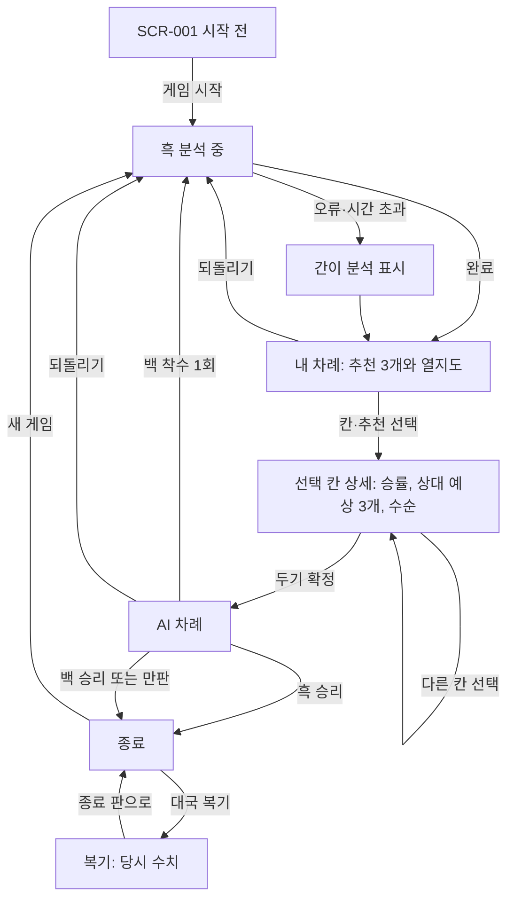

# 기획 준비안: 시각적 분석 보조가 붙은 AI 대국 오목

- 작성일: 2026-10-23
- 사용한 절차: `planning-skill`(JOEFLOW, State 0.2.0)의 DISCOVER와 CLOSE 준비 단계까지 진행했습니다.
- 하지 않은 것: `state.json` 생성, 스크립트 실행, 구현, `project/` 수정. 이 문서는 정본이 아닌 준비 자료입니다. 아래 ID(EVD/UNK/SCR/FLOW)는 나중에 `state.json`에 등록할 때 쓸 임시 번호입니다.
- 상태: 사용자 질문 직전 단계입니다. 결정된 것도, 승인된 것도 없습니다.

---

## 1. 근거

### 1.1 사용자 요청 해석 (원문 기준)

> "지금 오목 게임을 AI 보조 도우미가 실제로 작동하는 AI 대국 오목 게임으로 만들어봐. 서로 대화를 주고받는게 아니라 추천 수와 경우의 수, 상대의 예상 수와 각 위치 별 승률을 가시적으로 알려주는 제한적 알고리즘을 쓰는 거임. 상호작용하는 LLM이 아니라."

| 요청 요소 | 확실한 의미 | 모호한 점 |
|---|---|---|
| AI 대국 오목 게임 | 사람이 AI와 대국합니다. | 지금처럼 단계마다 사람이 "AI 응수 보기"를 눌러야 하는지, AI가 바로 두는지 |
| AI 보조 도우미가 실제로 작동 | 보조 기능이 실제 계산 결과를 보여줘야 합니다. | 지금 보조가 고장 났다고 느낀 것인지, 정보가 너무 적다는 뜻인지 |
| 대화가 아니다 / LLM이 아니다 | 생성형 언어 모델·채팅창·외부 AI API를 쓰지 않습니다. | 기존 문장형 해설 카드까지 줄이라는 뜻인지 |
| 추천 수 | 추천 위치를 판 위에 표시합니다. | 몇 개를 보여줄지 (지금은 1개) |
| 경우의 수 | 무언가의 가짓수나 갈래를 보여줍니다. | 검토한 후보 개수, 예상 수순 트리, 시뮬레이션 승·패·무 횟수 중 무엇인지 |
| 상대의 예상 수 | 상대가 둘 만한 자리를 보여줍니다. | 몇 개를 언제 보여줄지 (지금은 내가 둔 뒤 1개) |
| 각 위치 별 승률 | 교차점마다 승률 숫자나 색을 보여줍니다. | 승률을 어떻게 계산하는지, 누구 기준인지, 모든 빈칸에 보여주는지 |
| 제한적 알고리즘 | 규칙 기반이나 탐색 알고리즘을 쓰며, 한계가 있다는 것을 사용자도 받아들입니다. | 탐색 깊이와 시간 예산 |

### 1.2 기존 프로젝트에서 확인한 사실 (관찰 근거)

| 임시 ID | 출처 | 확인 내용 | 근거 종류 |
|---|---|---|---|
| EVD-001 | `project/BRIEF.md` | 제품 원본 목표는 "함께 배우는 AI 오목"으로, 처음 배우는 사람을 위한 학습 앱입니다. 15×15 자유 오목, 금수 없음, 사람은 흑으로 선공합니다. 로컬 AI만 쓰며 로그인·외부 AI API·수집·배포는 없습니다. | 사용자 의도 (보존 대상) |
| EVD-002 | `BRIEF.md` 3번째 항목 | "실제 승률을 산출·검증할 근거가 없다면 임의의 퍼센트를 승률처럼 내놓지 마세요." 예상 수는 확정된 미래가 아닌 가능한 대응으로 표현해야 합니다. | 사용자 의도. **새 요청과 충돌** |
| EVD-003 | `README.md`, `main.ts`의 도움말·`position-card` 문구 | 화면에 "승률이나 최종 결과의 예측이 아닙니다", "유불리는 연결 모양에 대한 평가이며 승률이 아닙니다"라고 명시되어 있습니다. | 관찰된 구현 |
| EVD-004 | `DESIGN.md` v0.1 | "랭킹·승률 게이지는 두지 않는다"라고 적혀 있습니다. 다만 이 시각안은 **사용자 승인 없음**으로 표시되어 있습니다. | 담당자 제안 (승인되지 않음) |
| EVD-005 | `src/engine.ts`, `Library/engine-notes.md` | AI는 이미 LLM이 아닌 제한 알고리즘입니다. 즉시 승리와 방어를 먼저 보고, 주변 2칸 안에서 후보 12개를 고른 뒤 2 ply minimax를 합니다. 평가 함수는 길이 5 창의 가중치 합 H(±100,000)입니다. 해설은 고정 문장 템플릿입니다. | 관찰된 구현 |
| EVD-006 | `engine.ts`의 `Analysis` 타입 | 결과에는 추천 1수(`move`), 설명 1개, 내 수 평가 1개, 판 요약 1줄(정성 문구)만 있습니다. 후보별 점수, 여러 추천, 상대 응수 목록, 수순, 칸별 수치는 **밖으로 내보내지 않습니다.** | 관찰된 구현 |
| EVD-007 | `controller.ts`, `ROADMAP.md`의 학습 흐름 | 진행 순서는 `intro → thinking(흑) → human → thinking(백) → review → [AI 응수 보기 클릭] → 백 착수 → thinking(흑)`입니다. 백은 사람이 버튼을 눌러야 둡니다. 예상 백 수와 실제 백 수는 같은 분석 결과를 재사용합니다. | 관찰된 구현 + 담당자가 고른 흐름 (사용자 승인 없음) |
| EVD-008 | `analysis-client.ts`, `protocol.ts` | 분석은 전용 Worker 1개에서 돌아갑니다. 2초 안에 응답이 없으면 간이 분석(1 ply)으로 바꿉니다. gameId·revision·requestId·key·engineVersion이 모두 맞아야 결과를 적용합니다. 새 게임과 되돌리기 때 Worker를 종료합니다. | 관찰된 구현과 문서화된 계약 (ROADMAP A3, UDO2) |
| EVD-009 | `ROADMAP.md` P4·P5, `README.md` | 되돌리기(redo 없음)와 종료 후 복기(이전 수/다음 수)가 완료되어 있습니다. 복기 프레임에는 당시 해설이 저장됩니다. | 관찰된 구현과 사용자 후속 요청 |
| EVD-010 | `ROADMAP.md` 범위 밖 목록 | 난이도 선택, 기보 저장, 심화 분석은 "선택적인 나중 아이디어"입니다. 온라인 대전, 렌주, 프로 엔진은 범위 밖입니다. | 담당자 기록 |
| EVD-011 | `TASK.md` 2026-10-23 | 최신 점검에서 핵심 흐름(추천 → 착수 → 예상 → 응수 → 되돌리기)이 정상 작동했습니다. 미결 앱 결함은 없습니다. 다음 후보로 "설명/위협 표시, 기보, 난이도/수읽기"가 적혀 있었고, 사용자가 고르기를 기다리던 상태였습니다. | 관찰된 실행 |
| EVD-012 | `DESIGN.md`, `ROADMAP.md` U2 | 화면 기준은 1440×900(판 520px + 설명 350px)과 390×844(판 폭 358px 이내)입니다. 색만으로 정보를 구별하지 않고, 키보드 조작과 live 알림을 지원합니다. | 담당자 제안과 검사 기준 |
| EVD-013 | `TASK.md`, `ROADMAP.md` P3 | 성능은 정식으로 측정한 적이 없습니다. 800ms 목표는 보장된 값이 아닙니다. 느린 기기에서는 검증하지 않았습니다. | 관찰 (한계) |
| EVD-014 | `README.md`의 실행 경로 | 문서 속 경로는 `D:/JOEWRKS/AI-Gomoku/app`인데, 실제로 받은 사본은 다른 경로에 있습니다. 기능 판단에는 영향이 없습니다. | 관찰 |

### 1.3 발견한 모순과 쟁점

- **CON-001 (중대): 승률 표시 금지와 위치별 승률 요청이 충돌합니다.** BRIEF는 근거 없는 퍼센트 승률을 금지합니다(EVD-002). 현재 구현과 디자인도 승률을 명시적으로 배제합니다(EVD-003, EVD-004). 새 요청은 "각 위치 별 승률"을 명시적으로 요구합니다. 새 요청이 더 최근의 사용자 지시이지만, BRIEF의 조건은 "근거가 없다면"입니다. 따라서 승률을 **근거 있게 산출하는 방법**을 정하면 두 지시를 모두 지킬 수 있습니다. 해소하려면 사용자 결정이 필요합니다(UNK-001).
- **CON-002: 학습 앱의 정체성과 대국·분석 앱의 정체성이 갈립니다.** 지금 화면은 "한 수의 이유", "함께 배우기"처럼 문장형 코치 중심입니다. 요청은 "대화가 아닌 가시적 수치"를 원합니다. 기존 해설 카드를 유지할지, 축소할지, 대체할지 결정이 필요합니다(UNK-002).
- **CON-003: 수동 응수 단계와 "대국"의 의미가 다를 수 있습니다.** 지금은 사람이 버튼을 눌러야 AI가 둡니다(EVD-007). 이 흐름은 담당자가 고른 것으로, 사용자가 승인한 적이 없습니다(UNK-003).
- **쟁점: "실제로 작동하는"의 의미가 불명확합니다.** 최신 점검에서 결함은 없었습니다(EVD-011). 사용자가 결함을 겪었다는 뜻인지, 정보량이 부족하다는 뜻인지 확인이 필요합니다(UNK-004).

### 1.4 근거만으로 정리되는 사항 (질문하지 않음)

- 로컬 알고리즘만 사용합니다. LLM·채팅·외부 AI API·서버는 쓰지 않습니다. 요청 원문과 BRIEF가 일치합니다.
- 규칙은 15×15 자유 오목, 금수 없음, 5개 이상이면 승리를 유지합니다(BRIEF).
- 예상 수는 "가능한 대응"으로 표현하고 확정된 미래처럼 말하지 않습니다(BRIEF, 새 요청과 충돌 없음).
- 분석 결과는 해당 판에만 적용하고, 오래된 결과는 버리며, AI 돌은 한 번만 놓습니다. 기존 A3·UDO2 계약을 유지합니다. 비동기 위험 영역 가운데 반드시 사용자가 정해야 하는 idempotency와 duplicate_execution 축은 기존 문서화된 계약으로 해소된다고 봅니다. 다만 승인 단계에서 다시 확인받습니다.
- 지원 화면은 1440×900과 390×844, 키보드 조작과 live 알림을 유지합니다(EVD-012).
- 로그인·결제·업로드·권한은 해당 사항이 없습니다.

### 1.5 위험 영역(Grill) 판정 초안

| 영역 | 판정 | 이유 |
|---|---|---|
| Core | 적용 | 항상 적용됩니다. |
| ASYNC | **적용** | Worker 분석의 대기, 시간 초과, 취소, 늦은 결과, 부분 완료가 모두 해당합니다. 특히 `partial_completion`은 반드시 사용자가 정해야 하는 축이라 UNK-008로 등록합니다. |
| DESTRUCTIVE_ACTION | 영향 없음 (기존 유지) | 새 게임 확인과 되돌리기는 이번 기능에서 바뀌지 않습니다. 만약 바뀌면 다시 검토합니다. |
| AUTH / MONEY / FILE_UPLOAD / PERMISSION | 해당 없음 | 근거는 EVD-001입니다. |

---

## 2. 사용자에게 물을 미결 결정 (우선순위 순)

실제 진행에서는 한 번에 한 질문만, 1번부터 묻습니다. 앞 질문의 답에 따라 뒤 질문이 사라지거나 바뀔 수 있습니다.

### UNK-001: "승률"을 무엇으로 계산하고 어떻게 부를까요? (최우선, 고위험)
- **중요한 이유:** BRIEF의 "근거 없는 승률 금지"와 정면으로 부딪칩니다. 알고리즘, 성능, 문구, 도움말, 테스트 전체가 이 답에 따라 달라집니다.
- **선택지:**
  - **A. 시뮬레이션 추정 승률.** 각 후보 칸에 돌을 놓았다고 가정하고, 정해진 정책으로 끝까지 가상 대국을 N판 둡니다. 실제로 이긴 비율을 %로 보여줍니다. 표본 수(예: "200판 중")와 "추정"이라는 표시를 붙입니다. 측정한 값이므로 BRIEF의 "근거" 조건을 충족합니다. 단점은 두 가지입니다. 무작위에 가까운 가상 대국은 값이 50% 근처로 몰려 변별력이 떨어집니다. 전술을 반영한 가상 대국을 쓰면 계산이 늘어납니다. 실제 대국 승률과 같다는 보장도 없습니다.
  - **B. 유리도 점수 (0–100).** 기존 평가값 H를 척도로 바꿔 표시하고, "승률"이 아닌 "유리도"라고 부릅니다. 빠르고 안정적이지만 요청한 "승률"과 다릅니다.
  - **C. 퍼센트 승률을 그대로 표기.** 산출 방식은 담당자에게 맡기고, BRIEF의 승률 조항은 폐기합니다. 근거가 약한 숫자가 승률처럼 보일 위험이 큽니다.
  - **D. 승률 없이 단계로만 표시** (매우 유리 / 유리 / 비슷 / 불리 등). 가장 정직하지만 요청에서 멀어집니다.
- **추천: A.** 화면 이름은 "추정 승률"로 하고 표본 수를 함께 표시합니다. 즉시 승리나 즉시 패배가 확정된 칸은 시뮬레이션 대신 규칙 판정 결과("이 수로 승리", "상대 즉시 승리 허용")로 표시합니다.
- **영향:** BRIEF 해석, 엔진, 도움말, 화면 문구, 테스트, 성능.

### UNK-002: 기존 문장형 해설("한 수의 이유" 카드)을 어떻게 할까요?
- **중요한 이유:** "대화가 아니라"는 말이 해설 문장까지 줄이라는 뜻인지 불분명합니다. 앱의 정체성(학습 앱인지, 대국·분석 앱인지)과 화면 전체 구성이 이 답에 달려 있습니다.
- **선택지:**
  - **A.** 수치·판 표시를 주 화면으로 삼고, 문장은 짧은 근거 꼬리표 한 줄만 남깁니다(예: "백 4목 방어").
  - **B.** 기존 해설 카드를 그대로 두고 수치 패널을 추가합니다.
  - **C.** 문장 해설을 모두 없애고 수치와 판 표시만 남깁니다.
- **추천: A.** 요청의 "가시적으로"를 따르면서도 "왜 그 수치인지"를 확인할 사실 근거는 남깁니다. 제목과 문구("함께 배우는")를 바꿀지는 이 답에 따릅니다.
- **영향:** 오른쪽 패널, 복기 카드, 도움말, 브랜딩 문구.

### UNK-003: AI가 바로 응수할까요, 지금처럼 버튼을 눌러야 둘까요?
- **중요한 이유:** 핵심 흐름과 컨트롤러 상태 전환, 그리고 "상대 예상 수"를 언제 보여줄지가 이 답으로 결정됩니다.
- **선택지:**
  - **A.** 내가 착수하면 AI가 짧은 지연 뒤 자동으로 둡니다. 예상 수는 착수 **전**, 칸을 선택했을 때 미리 보여줍니다.
  - **B.** 지금처럼 착수 뒤 예상 수를 보여주고, "AI 응수 보기"를 눌러야 AI가 둡니다.
  - **C.** A와 B를 설정으로 고를 수 있게 합니다.
- **추천: A.** "대국"에 가까운 흐름이고, 정보는 착수 전 미리보기로 충분히 제공됩니다. C는 범위만 키웁니다.
- **영향:** FLOW-002·003, 되돌리기 규칙의 문구, E2E 테스트 전체.

### UNK-004: 지금 보조 기능이 "작동하지 않는다"고 느낀 구체적인 증상이 있었나요?
- **중요한 이유:** 결함이 있다면 신규 기능과 별개로 먼저 고쳐야 합니다. 최근 점검에서는 결함이 발견되지 않았습니다(EVD-011).
- **선택지:**
  - **A.** 특정 증상이 있었습니다 (화면이나 단계를 알려주세요).
  - **B.** 결함은 없고, 보여주는 정보(추천 1개와 문장)가 너무 적다는 뜻이었습니다.
- **추천:** B로 가정하지 않고 확인합니다. 한 줄 답이면 충분합니다.
- **영향:** 작업 범위 (결함 수정 트랙을 추가할지).

### UNK-005: "경우의 수"로 무엇을 보여줄까요?
- **중요한 이유:** 데이터 구조와 화면 요소가 완전히 달라집니다.
- **선택지:**
  - **A. 예상 수순.** 추천 수마다 "내 수 → 상대 응수 → 내 다음 수"처럼 3–4수 앞의 대표 수순을 판 위 번호로 보여줍니다.
  - **B. 결과 횟수.** 시뮬레이션 N판 중 승·패·무가 각각 몇 판이었는지 보여줍니다 (UNK-001에서 A를 고른 경우).
  - **C. 검토 규모.** 이 판에서 둘 수 있는 칸 수와 실제로 검토한 후보 수를 보여줍니다 (예: "빈칸 210 중 후보 15 검토").
  - **D.** 위 항목의 조합.
- **추천: A와 B의 조합.** C는 정보로서 가치가 낮아 패널 하단에 작은 글씨로만 둡니다.
- **영향:** 엔진 출력, 패널 구성, 판 위 표시 겹침 규칙.

### UNK-006: 위치별 승률을 어느 칸까지 보여줄까요?
- **중요한 이유:** "각 위치"를 문자 그대로 225칸 전부로 해석하면 브라우저 계산 시간이 크게 늘어납니다. 모바일 판(358px)에서는 칸마다 숫자를 읽기도 어렵습니다.
- **선택지:**
  - **A.** 기존 돌 주변 후보 칸(최대 20개 안팎)만 계산하고 색과 숫자로 표시합니다. 나머지 칸은 "미계산"으로 둡니다.
  - **B.** 모든 빈칸을 계산합니다. 정밀도를 낮추거나 시간이 오래 걸리는 것을 감수합니다.
  - **C.** 판 위에는 상위 N개만 숫자로 표시합니다. 다른 칸은 사용자가 선택했을 때만 계산해서 보여줍니다.
- **추천: A에 C의 "선택 시 계산"을 더한 방식.** 후보 칸은 바로 보여주고, 그 밖의 칸을 선택하면 그 칸만 따로 계산합니다.
- **영향:** 성능 예산, 판 위 표시 방식, 접근성 라벨.

### UNK-007: 추천 수를 몇 개 보여줄까요?
- **선택지:** A. 상위 3개(순위 표시) / B. 상위 5개 / C. 1개(현재와 같음)
- **추천: A. 3개.** 판이 덜 복잡하고, 모바일에서도 구별이 됩니다.
- **영향:** 판 표시, 패널 목록, 선택 단축 버튼.

### UNK-008: 분석이 시간 안에 끝나지 않으면 어떻게 할까요? (비동기 영역, 부분 완료 처리)
- **중요한 이유:** 시뮬레이션은 시간이 걸릴수록 정확해집니다. 지금 규칙은 "중단된 탐색의 일부 점수는 표시하지 않는다"입니다(EVD-008). 부분 결과를 보여주면 이 규칙을 바꿔야 합니다.
- **선택지:**
  - **A.** 계산이 진행되는 동안 수치를 점진적으로 갱신하면서 표본 수를 함께 보여줍니다. 시간 한도(예: 3초)에 도달하면 그때까지의 값으로 확정하고 "표본 적음"을 표시합니다.
  - **B.** 끝까지 기다린 뒤 한 번에 보여줍니다. 한도를 넘기면 지금처럼 간이 분석(수치 없음)으로 바꿉니다.
  - **C.** 계산 정밀도(빠름/정밀)를 사용자가 고르게 합니다.
- **추천: A.** 대기 체감이 짧고, 표본 수를 함께 보여주므로 정직합니다. 다만 숫자가 화면에서 계속 움직이는 것을 사용자가 싫어할 수 있어 확인이 필요합니다.
- **영향:** Worker 프로토콜(중간 메시지), 늦은 결과 처리, 간이 분석 문구.

### UNK-009: 승률은 누구 기준으로 보여줄까요?
- **선택지:**
  - **A.** 항상 사람(흑) 기준. 예상 상대 수에도 "이 수를 두면 내 승률 ○%"를 붙입니다.
  - **B.** 그 칸에 둘 차례인 쪽 기준. 상대 예상 수는 상대(백)의 승률로 표시합니다.
- **추천: A.** 한 화면에서 기준이 바뀌지 않아 헷갈리지 않습니다.
- **영향:** 문구, 색상 척도의 방향.

### UNK-010: AI 상대의 강도를 고를 수 있게 할까요?
- **선택지:**
  - **A.** 이번에는 강도 1종. 상대 AI가 보조 분석과 같은 엔진을 씁니다.
  - **B.** 쉬움/보통 2–3단계를 추가합니다.
- **추천: A.** 강도를 검증한 적이 없어서 단계 이름을 정직하게 붙이기 어렵습니다. 범위도 커집니다.
- **영향:** 범위, 설정 화면 필요 여부.

### UNK-011: 보조 표시를 끄고 둘 수 있게 할까요?
- **선택지:**
  - **A.** 상단 토글로 켜고 끕니다. 기본값은 켜짐입니다.
  - **B.** 항상 켜져 있습니다.
- **추천: A.** "보조 도우미"라는 성격에 맞습니다. 보조 없이 실력을 시험하는 대국도 가능해집니다.
- **영향:** 상태 하나, 토글 UI 하나, 분석을 요청하는 시점 (꺼져 있을 때는 AI 착수용 계산만 합니다).

### UNK-012: 사람이 백(후공)도 고를 수 있게 할까요?
- **선택지:** A. 흑 고정 유지 (BRIEF와 같음) / B. 시작 전에 흑이나 백을 고릅니다.
- **추천: A.** 이번 요청에는 언급이 없습니다. B는 되돌리기·복기 규칙까지 다시 써야 합니다.
- **영향:** 범위.

### UNK-013: 복기에도 승률 정보를 보여줄까요?
- **선택지:**
  - **A.** 복기의 각 수에 당시 추정 승률과 추천 수를 함께 보여줍니다. 대국 전체의 승률 추이 그래프를 추가합니다.
  - **B.** 각 수에 당시 수치만 저장해서 보여주고, 그래프는 없습니다.
  - **C.** 복기는 지금 그대로 둡니다.
- **추천: B.** 저장할 것만 늘리고 새 화면은 만들지 않습니다. 그래프는 다음 단계로 미룹니다.
- **영향:** 복기 프레임 데이터, 메모리 사용량.

---

## 3. 담당자가 정할 비중요 결정

아래 항목은 국소적이고 되돌리기 쉬우며, 위 결정의 의미를 바꾸지 않습니다. 위 답에 따라 범위만 조정합니다.

1. **탐색 알고리즘 세부:** 전술 우선 필터(즉시 승리, 유일한 방어)를 유지한 채 후보를 제한합니다. 그 위에 정책 기반 플레이아웃을 쓸지, 소규모 MCTS를 쓸지, 가중치와 플레이아웃 정책을 어떻게 할지 정합니다. 즉시 승리와 즉시 패배 칸은 시뮬레이션 대신 규칙으로 판정합니다.
2. **재현성:** 같은 판·같은 설정이면 같은 수치가 나오도록 판 key로 난수 시드를 고정합니다. 테스트와 되돌리기 후 재분석이 일관됩니다.
3. **프로토콜:** `engineVersion` 값을 올리고 결과 타입을 확장합니다(후보 목록, 칸별 수치, 표본 수, 수순, 상대 응수 목록). 기존 일치 검사와 취소 규칙은 그대로 둡니다. 중간 결과 메시지 형식은 UNK-008이 A일 때만 만듭니다.
4. **판 위 표시 문법** (DESIGN의 원칙인 "색만으로 구별하지 않음" 유지):
   - 추천: 실선 고리와 순위 숫자
   - 상대 예상 수: 점선 고리와 "예상" 글자, 순위
   - 승률: 칸 배경에 단색 계열의 명도 척도와 숫자
   - 수순: 작은 번호
   - 여러 표시가 겹칠 때의 우선순위
5. **숫자 형식:** 정수 %, 표본 수 표기("200판"), 확정 결과 문구("즉시 승리", "상대 즉시 승리 허용"), 계산하지 않은 칸 표시를 정합니다.
6. **배치:** 1440×900에서는 오른쪽 패널을 수치 목록 중심으로 다시 구성합니다. 390×844에서는 판 아래에 접을 수 있는 패널을 두고, 칸을 누르면 그 칸의 상세를 보여줍니다. 가로 넘침은 없어야 하고 기존 터치 확정 절차는 유지합니다.
7. **접근성:** 각 칸의 aria 라벨에 추천 순위, 예상, 승률을 덧붙입니다. 분석 완료는 live 알림으로 한 번만 알립니다. 225칸을 매번 읽지 않는 기존 원칙을 유지합니다.
8. **도움말 문구:** 추정 승률의 뜻, 표본 수, 한계(전역 최선이 아님, 강도는 미검증)를 설명합니다. 기존 "승률이 아닙니다" 문구는 UNK-001 답에 맞게 교체합니다.
9. **기존 기능:** 되돌리기(redo 없음), 새 게임 확인, 늦은 결과 거절, Worker 2초 감시는 유지합니다. 시간 값은 UNK-008 답에 맞춰 조정합니다.
10. **검증 계획:**
    - 단위 고정 판: 즉시 승리 칸은 승리로 확정, 4목 방치 칸은 패배 허용 표시, 대칭 판에서 수치가 대칭에 가까운지 확인합니다.
    - 성능: 중반 판 20개에서 분석 시간을 실제로 측정합니다(이전에는 측정하지 않았음).
    - E2E: 두 화면 크기에서 기존 62/18 회귀 테스트와 새 흐름을 확인합니다.
    - 강도와 교육 효과는 계속 "미검증"으로 표시합니다.
11. **문서:** BRIEF는 보존합니다. ROADMAP에 P6 단계를 추가하고 TASK와 ISSUES에 기록합니다. DESIGN의 "승률 게이지 없음" 문구는 UNK-001 답을 반영해 고칩니다.
12. **브랜딩 문구:** UNK-002 답에 따라 보조 문구만 조정합니다. 앱 이름 자체는 바꾸지 않는 것을 기본값으로 합니다.

---

## 4. 화면 명세와 사용자 흐름 초안

> 추천안(UNK-001 A, 002 A, 003 A, 005 A+B, 006 A+C, 007 3개, 008 A, 009 흑 기준, 010 1종, 011 토글, 012 흑 고정, 013 B)을 가정한 초안입니다. 답이 다르면 해당 부분을 다시 씁니다.

### SCR-001: 대국 화면 (단일 화면, 기존 화면을 개편)

- **진입:** 앱 첫 화면 → "게임 시작"
- **사용자:** 로컬 사용자 1명. 권한과 로그인은 없습니다.
- **정보 계층** (데스크톱은 왼쪽 판, 오른쪽 패널. 모바일은 세로 순서):
  1. **상단:** 앱 이름, 보조 표시 토글 [켬/끔], 규칙·도움말, 새 게임
  2. **판 머리:** 나(흑) vs AI(백), 수 번호와 차례, 분석 상태("분석 중 · 120/200판")
  3. **판 (15×15)과 겹쳐 표시하는 층:**
     - 실제 돌, 마지막 수 점, 승리선
     - 승률 열지도 (후보 칸만, 단색 명도와 숫자)
     - 추천 고리와 순위 ①②③
     - 선택 칸의 사각 테두리
     - 선택 칸 기준 상대 예상 수 (점선 고리와 순위)
     - 예상 수순 번호 (선택한 추천을 보는 동안만)
  4. **행동 영역:** 선택 좌표, "H8에 두기", ↶ 되돌리기
  5. **분석 패널:**
     - (a) 추천 수 목록 3행: 순위, 좌표, 추정 승률, 표본, 근거 꼬리표 1줄. 행을 누르면 그 칸이 선택됩니다.
     - (b) 선택 칸 상세: 내 추정 승률, 승·패·무 판수, 상대 예상 수 상위 3개(각각을 둔 뒤 내 승률), 대표 수순
     - (c) 판 요약 1줄과 계산 범위("빈칸 210 중 후보 18 계산")
     - (d) 한계 안내: "추정치 · 전역 최선 아님"
  6. **도움말 대화상자:** 규칙, 조작, 추정 승률의 뜻과 한계
- **주요 행동:** 칸 선택, 추천 행 선택, 착수 확정, 되돌리기, 보조 토글, 다시 분석, 새 게임(확인 포함), 도움말, 복기 진입·이동·종료
- **데이터:** 모두 메모리에만 둡니다. 새로고침하면 초기화됩니다. 외부 전송은 없습니다.

| 상태 | 해당 | 시점 | 화면 동작 | 복구 |
|---|---|---|---|---|
| 시작 전 (Default) | 예 | 첫 진입 | 규칙 3줄, "게임 시작" | 없음 |
| 분석 중 (Loading/Partial) | 예 | 내 차례 시작, 칸 선택 시 | 수치가 점진적으로 갱신되고 표본 수 표시. 착수 버튼은 쓸 수 있습니다 (분석을 기다리지 않아도 됨, 담당자 판단 후 확정) | 다시 분석 |
| 분석 완료 (Success) | 예 | 시간 한도 내 완료 | 추천 3개, 열지도, 패널 확정 | 없음 |
| 표본 부족 (Partial) | 예 | 시간 한도 도달 | 값 옆에 "표본 적음" 배지 | 다시 분석 |
| 간이 분석 (Error/Timeout) | 예 | Worker 오류 또는 무응답 | 수치를 숨기고 "간이 분석 · 즉시 위협만 확인". AI 착수는 계속 진행 | 다시 분석 |
| 칸 선택됨 | 예 | 빈칸 선택 | 선택 칸 상세와 상대 예상 수 표시. 상세 계산 중 표시 | 다른 칸 선택 |
| AI 차례 (Submitting) | 예 | 확정 직후 | "AI가 두는 중", 입력 잠금. 새 게임과 되돌리기는 사용 가능 | 되돌리기 |
| 종료 (Completed) | 예 | 승리, 패배, 무승부 | 결과, 승리선, 복기, 새 게임. 분석 표시 중지 | 새 게임 |
| 복기 | 예 | 종료 후 | 각 수에 당시 추정 승률과 추천 표시 (UNK-013 B). 착수 불가 | 종료 판으로 |
| 보조 끔 (Disabled) | 예 | 토글 끔 | 판 위 층과 패널 수치를 숨기고 AI 대국만 진행 | 토글 켬 (현재 판을 즉시 분석) |
| Empty / 권한 / 인증 / 오프라인 / 만료 | 해당 없음 | 로컬 단일 사용자이며 네트워크를 쓰지 않음 | | |

### 사용자 흐름

- **FLOW-001: 시작**
  - 시작 → 새 판(gameId 증가) → 흑 분석 요청 → 추천 3개와 열지도 표시. 빈 판은 H8 하나만 추천할 수 있습니다(규칙으로 확정).

- **FLOW-002: 내 차례 (핵심)**
  1. 추천과 열지도를 봅니다.
  2. 칸을 선택하거나 추천 행을 누릅니다.
  3. 선택 칸의 상세가 나타납니다: 내 추정 승률, 승·패·무, 상대 예상 수 상위 3개, 대표 수순. 후보가 아닌 칸이면 그 칸만 따로 계산합니다.
  4. 다른 칸을 선택하면 상세가 바뀝니다 (이전 계산은 취소하고 늦게 온 결과는 버립니다).
  5. "좌표에 두기"를 누르면 흑 1개를 놓습니다.
  - 분기:
    - 즉시 승리 → FLOW-005
    - 이미 막을 수 없는 판 → 상세에 "상대 즉시 승리 2곳"처럼 사실로 표시합니다.

- **FLOW-003: AI 응수 (UNK-003 A 기준)**
  - 확정 → AI 차례 상태 → 백 분석(같은 엔진) → 결과가 현재 판과 맞으면 백을 한 번만 착수 → 내 차례 분석(FLOW-002)
  - 실패하거나 시간을 넘기면 간이 응수로 진행하고 한계를 표시합니다. 늦게 온 결과는 무시합니다.

- **FLOW-004: 분석 실패와 부분 완료**
  - 시간 한도에 도달하면 그때까지의 표본으로 값을 확정하고 "표본 적음"을 표시합니다.
  - Worker 오류가 나면 수치를 숨기고 간이 분석을 표시합니다.
  - "다시 분석"을 누르면 같은 판으로 새 요청을 보냅니다. 판은 그대로 유지합니다.

- **FLOW-005: 종료와 복기**
  - 승리·패배·무승부가 나면 결과와 승리선을 보여주고 분석을 멈춥니다.
  - 대국 복기로 들어가면 0수부터 이전 수/다음 수로 이동하며, 각 수의 당시 수치를 기준 수와 함께 표시합니다.
  - 종료 판으로 돌아오거나 새 게임을 시작할 수 있습니다.

- **FLOW-006: 되돌리기**
  - 지금 규칙과 같습니다. 직전 흑 수와 그 뒤 백 수를 함께 취소합니다.
  - 이후 복원된 판을 다시 분석하고, 분석이 끝날 때까지 중복 되돌리기를 막습니다.
  - 취소된 분석의 늦은 결과는 버립니다. 취소된 수는 복기 기록에서 제거합니다.

- **FLOW-007: 보조 토글**
  - 끄면 판 위 층과 패널 수치를 숨깁니다. AI 착수용 계산만 계속합니다.
  - 켜면 현재 판을 즉시 분석합니다. 이전에 끈 상태에서 계산한 값은 재사용하지 않습니다.

### 이 초안에서 아직 열려 있는 부분

화면의 의미는 UNK-001부터 UNK-013까지의 답에 묶여 있습니다. 특히 다음 세 부분은 답에 따라 다시 써야 합니다.
- UNK-003: AI 자동 응수 여부와 예상 수를 보여주는 시점
- UNK-008: 점진적 갱신 여부
- UNK-002: 문장 해설을 얼마나 남길지

시각안은 사용자 승인 전이며, 렌더링도 확인하지 않았습니다(`NOT_VERIFIED`).
